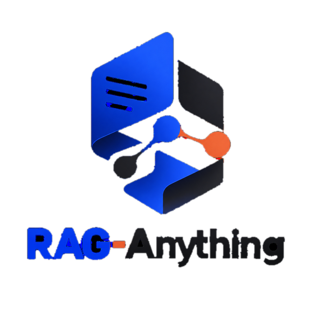
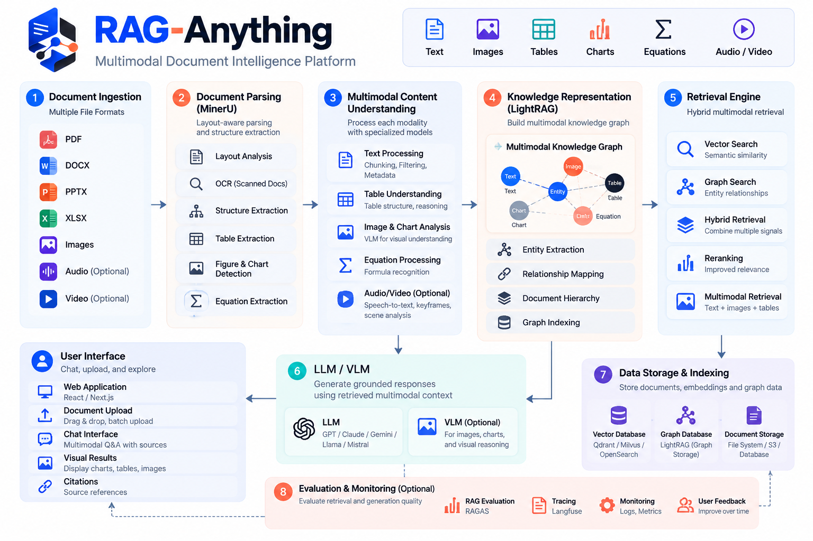

<div align="center">



### Multimodal Document Intelligence Platform

**Upload your documents. Ask questions. Get answers grounded in your own files, with sources.**

</div>

---

## Overview

RAG-Anything is a self-hosted web app for retrieval-augmented generation (RAG) over your own documents. Drop in PDFs, Word files, spreadsheets, notes or images, and chat with them. Behind the interface, each file is split into text, tables and images, turned into a knowledge graph plus vector index, and queried with hybrid retrieval, so answers can connect facts across several documents and cite where they came from.

## Features

- **Drag-and-drop library**: upload several files at once and watch each move through *Queued → Indexing → Ready*, with retry for failures.
- **Chat with sources**: every answer lists the documents it was drawn from, with numbered citations and a copy button.
- **Five retrieval modes**: mix, hybrid, local (entities), global (themes) and naive (text only).
- **Multimodal indexing**: text, tables (DOCX, CSV) and images (through a vision model).
- **Knowledge-graph retrieval**: entities and relations are extracted from your files and linked across documents.
- **Private by default**: the server binds to `127.0.0.1` and embeddings run on your machine. Only text sent to the LLM leaves it.
- **Polished UI**: light and dark themes, mobile-friendly, keyboard-friendly, chat history kept in your browser.

Supported files: `.pdf` `.docx` `.txt` `.md` `.csv` `.png` `.jpg` `.jpeg` `.webp`

## Architecture

<div align="center">
  
</div>

The diagram shows the full target platform. The table maps each stage to what this repository ships today.

| Stage | In this repository |
| --- | --- |
| 1. Document ingestion | Browser upload to the FastAPI service; files are queued and indexed one at a time |
| 2. Document parsing | Built-in parsers for PDF, DOCX, TXT/MD, CSV and images ([webapp/parsing.py](webapp/parsing.py)). MinerU and Docling are supported by the core library but are optional and not installed by default |
| 3. Multimodal understanding | Text chunking, table analysis and image description (vision model) from the `raganything` processors |
| 4. Knowledge representation | LightRAG knowledge graph (entities, relations) |
| 5. Retrieval engine | Vector + graph search, combined in the mix / hybrid modes |
| 6. LLM / VLM | Any OpenAI-compatible API; defaults to Groq (`openai/gpt-oss-120b`, `qwen/qwen3.8-27b`) |
| 7. Storage | LightRAG's local file storage under `data/`. Qdrant, Milvus, OpenSearch and others can be plugged in through the core library |
| 8. Evaluation and monitoring | Not included yet |
| User interface | Dependency-free web UI in [webapp/static/](webapp/static/) with upload, chat, sources and citations |

## Quick start

Requires Python 3.10+.

```bash
# 1. Create an environment and install
python -m venv .venv
.venv\Scripts\activate            # Windows  (Linux/macOS: source .venv/bin/activate)
pip install -r webapp/requirements.txt

# 2. Configure your key
copy .env.example .env            # Linux/macOS: cp .env.example .env
#    edit .env and set LLM_BINDING_API_KEY (Groq keys: https://console.groq.com)

# 3. Run
python -m webapp
```

Open <http://127.0.0.1:8765> (change the port with `PORT`). The first indexing run downloads a small embedding model (about 130 MB).

## Configuration

All settings live in `.env` (see [.env.example](.env.example)).

| Variable | Default | Purpose |
| --- | --- | --- |
| `LLM_BINDING_API_KEY` | none | API key for Groq or any OpenAI-compatible provider |
| `LLM_BINDING_HOST` | `https://api.groq.com/openai/v1` | API base URL |
| `LLM_MODEL` | `openai/gpt-oss-120b` | Model used for extraction and answers |
| `VISION_MODEL` | `qwen/qwen3.8-27b` | Model used to describe images |
| `EMBEDDING_MODEL` / `EMBEDDING_DIM` | `BAAI/bge-small-en-v1.5` / `384` | Local embedding model and its dimension |
| `HOST` / `PORT` | `127.0.0.1` / `8765` | Where the server listens |
| `DATA_DIR` | `./data` | Uploads, index and document registry |
| `MAX_UPLOAD_MB` | `50` | Per-file upload limit |
| `LLM_MAX_ASYNC` | `1` | Concurrent LLM calls |
| `CHUNK_TOKEN_SIZE` | `500` | Chunk size for indexing |
| `MAX_OUTPUT_TOKENS` / `MAX_CONTEXT_TOKENS` | `2000` / `4000` | Caps on model output and retrieved context |
| `RATE_LIMIT_RETRIES` | `8` | Retries (with long backoff) when the provider returns HTTP 429 |

Notes:

- The defaults are tuned for Groq's free tier, which allows about 8,000 tokens per minute per model. On a paid plan, raise `LLM_MAX_ASYNC`, `CHUNK_TOKEN_SIZE` and the token caps for faster, richer indexing.
- Changing `EMBEDDING_MODEL` or `EMBEDDING_DIM` after indexing requires deleting `data/rag_storage` and re-uploading.

## API

| Method | Path | Description |
| --- | --- | --- |
| `GET` | `/api/health` | Engine status and supported types |
| `GET` | `/api/documents` | List documents and their status |
| `POST` | `/api/upload` | Upload files (`multipart/form-data`, field `files`) |
| `POST` | `/api/documents/{id}/retry` | Re-queue a failed document |
| `DELETE` | `/api/documents/{id}` | Remove a document and its index entries |
| `POST` | `/api/query` | `{ "question": "...", "mode": "mix" }` returns `{ "answer": "..." }` |

## Project layout

```
webapp/        FastAPI server, ingestion queue, parsers and web UI (static/)
raganything/   Core multimodal RAG library (parsing, processors, retrieval)
assets/        Logo and architecture diagram
docs/          Guides for the core library
examples/      Library usage examples
tests/         Tests for the core library
```

## Security

There is no authentication. Keep the default `127.0.0.1` binding, or place the app behind an authenticating reverse proxy. Never commit `.env`. See [SECURITY.md](SECURITY.md).

## License and acknowledgements

Released under the [MIT License](LICENSE). The core pipeline in `raganything/` derives from the MIT-licensed [RAG-Anything](https://github.com/HKUDS/RAG-Anything) project by HKUDS and builds on [LightRAG](https://github.com/HKUDS/LightRAG). Their copyright notice is kept in the license, as the MIT License requires.
